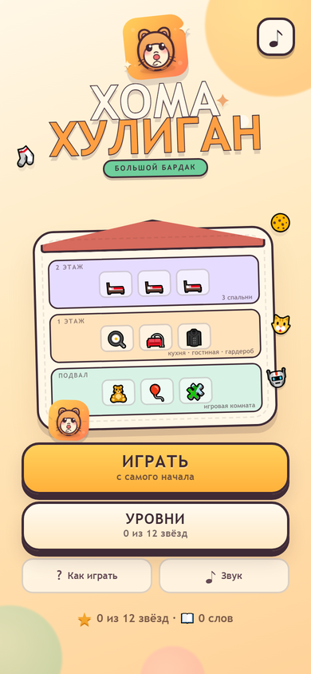
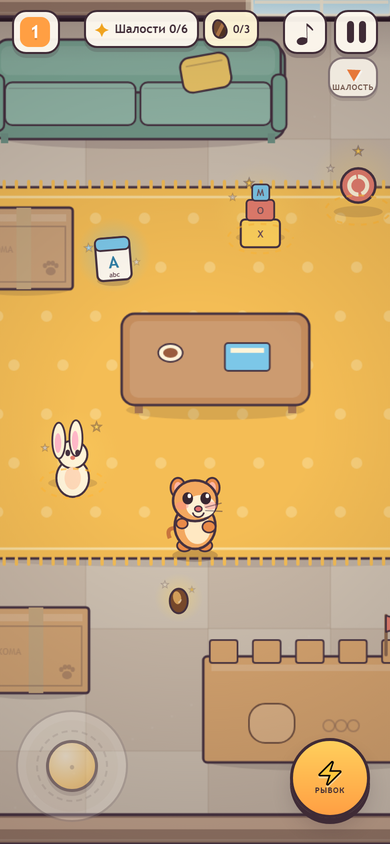
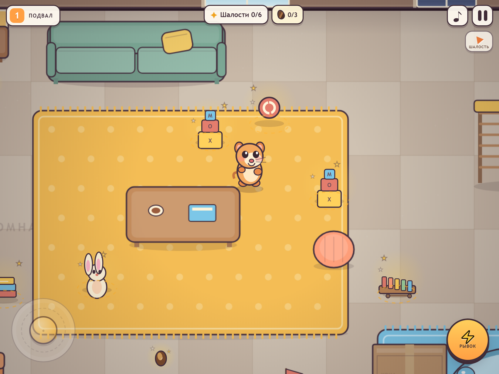

# 🐹 Хома-хулиган — Большой бардак

Весёлая браузерная игра про хомяка, который очень любит шалости. Четыре уровня, три этажа дома, мама, кошка Мурка и робот-пылесос — всё как в жизни, только смешнее.

Игра работает на **iPhone и iPad** (Safari), на планшетах, компьютерах и ноутбуках. Управление рассчитано на палец: виртуальный джойстик, большая кнопка рывка и кнопка пряток. Никакой рекламы, покупок и сбора данных.

## 🎮 Играть онлайн

**[https://prefab-dnk.github.io/homa-huligan/](https://prefab-dnk.github.io/homa-huligan/)**

Откройте ссылку в Safari на iPhone или iPad, нажмите «Поделиться» → «На экран “Домой”» — и игра будет запускаться с иконки. После первого запуска она работает офлайн.

## 📸 Как это выглядит

<p>
  
  
  
</p>

---

## 🚀 Быстрый запуск на компьютере (Windows)

1. Установи **Node.js** (если ещё не установлен): <https://nodejs.org/> → LTS.
2. Дважды кликни **`ЗАПУСТИТЬ-ИГРУ.cmd`** в этой папке.
3. Откроется браузер с игрой: `http://localhost:4173`.
4. Не закрывай чёрное окно консоли, пока играешь.

В консоли появится примерно такое:

```text
🐹 ХОМА-ХУЛИГАН запущен!

На этом компьютере:  http://localhost:4173
На телефоне/планшете: http://192.168.1.50:4173
```

---

## 📱 Как открыть на iPhone или iPad

Телефон/планшет и компьютер должны быть в **одной Wi-Fi сети**.

1. Запусти игру на компьютере (`ЗАПУСТИТЬ-ИГРУ.cmd`).
2. Посмотри в окне консоли строку **«На телефоне/планшете»** — например, `http://192.168.1.50:4173`.
3. На iPhone/iPad открой **Safari** и введи этот адрес.
4. Если Windows спросит про доступ к сети для Node.js — разреши (частные сети).
5. Нажми в Safari **«Поделиться» → «На экран “Домой”»**. Так игра будет запускаться с иконки, без адресной строки.

> Локальный сервер работает, пока включён компьютер и не закрыто окно консоли. Для полностью автономной установки (без компьютера) игру нужно положить на любой HTTPS-хостинг — см. ниже.

---

## 🌍 Чтобы игра работала совсем без компьютера

Подойдёт любой бесплатный статический хостинг с HTTPS:

- **Netlify Drop** — просто перетащить папку игры в окно браузера.
- **GitHub Pages** — загрузить папку в репозиторий и включить Pages.
- **Cloudflare Pages**, **Vercel** — аналогично.

Загружай **всю папку** (не только `index.html`): нужны `style.css`, `game.js`, `levels.js`, `art.js`, `manifest.webmanifest`, `sw.js` и папка `icons`.

После загрузки откройте ссылку на iPad в Safari и добавьте на экран «Домой». Service worker закэширует игру, и после первого запуска она будет работать **офлайн**.

---

## 🎮 Управление

| Действие | Как |
|---|---|
| Бежать | Веди пальцем по левой части экрана (виртуальный джойстик). На компьютере — стрелки или WASD. |
| Рывок | Большая оранжевая кнопка ⚡ справа. Помогает убежать от Мурки. |
| Спрятаться | Подойди к коробке, шкафу, кровати или корзине. Появится кнопка 👀 «ПРЯТКИ». |
| Пауза | Кнопка ⏸ в правом верхнем углу. |
| Звук | Кнопка ♪. |

**Цель уровня:** разбросать все предметы с золотыми искорками, собрать 3 семечка (по желанию) и добежать до норки/выхода/гнезда. Чем меньше раз тебя поймали — тем больше звёзд.

---

## 🏠 Уровни

1. **Подвал — «Игрушечный погром».** Большая игровая комната, игрушки и спящая Мурка.
2. **Первый этаж — «Кухня и гостиная».** Хлопья, печенье, цветок и мама с половником.
3. **Первый этаж — «Прихожая и гардероб».** Обувь, шарфы и очень деловой робот-пылесос.
4. **Второй этаж — «Три спальни».** Подушки, одеяла и самое уютное гнездо.

Прогресс и звёзды хранятся **только в браузере** на этом устройстве (`localStorage`). Сбросить прогресс можно в меню «Как играть» → «Сбросить прогресс».

---

## 🗂 Файлы

```text
index.html            — оболочка игры и экраны меню
style.css             — оформление интерфейса
levels.js             — четыре карты, задачи, враги, укрытия
art.js                — вся рисованная графика на Canvas
game.js               — игровой движок, управление, звук, сохранения
manifest.webmanifest  — PWA-манифест для установки на iPhone/iPad
sw.js                 — офлайн-кэш
icons/                — иконки приложения
server.js             — локальный сервер для запуска по Wi-Fi
ЗАПУСТИТЬ-ИГРУ.cmd   — запуск в один клик (Windows)
```

---

## 🛠 Если что-то не запускается

- **`node` не найден** — установи Node.js LTS и перезапусти `ЗАПУСТИТЬ-ИГРУ.cmd`.
- **Порт занят** — закрой старое окно консоли или запусти `set PORT=5000 && node server.js`.
- **iPad не открывает адрес** — проверь, что устройства в одной Wi-Fi сети, и разреши Node.js доступ в брандмауэре Windows.
- **Нет звука** — проверь переключатель звука в игре и режим «Без звука» на iPhone. Звук запускается после первого касания экрана — так требует iOS.
- **Сбросить прогресс** — открой «Как играть» → «Сбросить прогресс».

---

Сделано с любовью для маленьких хулиганов и их хомяков. Пусть бардак будет только в игре! 🐹🧦🍪
